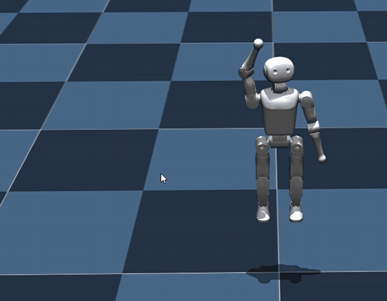

# Greeting Wave with a Nod

A humanoid greeting motion simulated on the **Booster K1** robot using
**MuJoCo** and Python, created for the **Final Challenge (KPP)** of the
**ICHIRO TechXperience: Exploring Python-based Robot Simulation through MuJoCo** workshop.

## Demo



## Overview

This project drives the 22 joints of the K1 robot to perform a greeting
motion of about 5.5 seconds. The right arm rises and waves in a sine-wave
pattern while the head nods and turns in sync. At the end, the right arm
slowly lowers until the robot comes to rest.

All joints are controlled with a **PD (Proportional-Derivative) controller**,
and every target angle is clamped to stay within the joint limits.

## Motion Timeline

| Time (s) | Phase | Description |
|---|---|---|
| 0.0 – 1.2 | Raise | The right arm rises along a smooth curve (smoothstep), with no jerk |
| 1.2 – 4.2 | Greet | The right elbow waves in a sine pattern while the head nods and turns |
| 4.2 – 5.5 | Lower | The right arm lowers slowly as the wave amplitude fades out |
| > 5.5 | Rest | The robot holds its final pose |

## How It Works

### PD Control
The K1 motors take **torque** as the control input. The torque of each joint
is computed from the difference between the target angle and the current angle:

```
ctrl = KP * (target - q) - KD * qvel
```

- `KP` (30.0) acts like a spring that pulls the joint toward the target.
- `KD` (1.5) acts like a brake that damps oscillation.
- `q` and `qvel` are the current joint position and velocity.

The calculation runs for all 22 joints at once using NumPy array operations.

### Actuated Joints

| Joint | Role |
|---|---|
| `right_shoulder_roll_joint` | Raises and lowers the right arm |
| `right_elbow_pitch_joint` | Bends the right elbow |
| `right_elbow_yaw_joint` | Produces the waving motion |
| `aahead_pitch_joint` | Nods the head |
| `aahead_yaw_joint` | Turns the head |
| `left_shoulder_roll_joint` | Keeps the left arm lowered |

All other joints stay at an angle of 0.

### Key Functions

| Function | Purpose |
|---|---|
| `target_angles(t)` | Returns the target angles of all joints at time `t` |
| `smooth(x)` | Smoothstep curve from 0 to 1 for seamless transitions |
| `find(*keywords)` | Looks up an actuator name by keywords |

Target angles are clipped (`np.clip`) to the joint ranges defined in the
model, so the motion never exceeds the allowed limits.

## Requirements

- [uv](https://docs.astral.sh/uv/), which manages Python and project dependencies
- Python packages: `mujoco`, `numpy` (installed through uv)
- The K1 model files from the workshop materials (`models/k1/K1_22dof.xml`)

> **Note:** The robot model files are workshop materials provided by the
> organizers and are not included in this repository.

## Setup

### 1. Install uv

**Windows (PowerShell):**

```powershell
powershell -ExecutionPolicy ByPass -c "irm https://astral.sh/uv/install.ps1 | iex"
```

**macOS / Linux:**

```bash
curl -LsSf https://astral.sh/uv/install.sh | sh
```

Close and reopen the terminal, then verify the installation:

```bash
uv --version
```

### 2. Create the project and install dependencies

```bash
uv init --bare my-k1-project
cd my-k1-project
uv add mujoco numpy
```

Copy the workshop `models/` folder and `my_motion.py` into this folder.
If you already have the workshop project (with `pyproject.toml`), run
`uv sync` in that folder instead.

### 3. Verify the installation

```bash
uv run python -m mujoco.viewer
```

An empty MuJoCo viewer window should open. If it does, the setup is complete.

## Usage

```bash
uv run python my_motion.py
```

The **MuJoCo : K1** viewer window opens and the robot starts moving right away.
The actuator names and the detected head joints are printed in the terminal.
Close the viewer window to stop the program.

## Customization

The motion parameters can be changed directly in `my_motion.py`:

| Parameter | Location | Effect |
|---|---|---|
| `T_UP`, `T_DOWN`, `T_END` | Motion phase constants | Sets the duration of each phase |
| `np.sin(5 * tw)` | `right_elbow_yaw_joint` line | Waving speed |
| `0.6` in `0.3 + 0.6 * ...` | `right_elbow_yaw_joint` line | Waving width |
| `0.25` | Head nod line | Nodding amplitude |
| `KP`, `KD` | Gains section | Stiffness and damping of the motion |

## Troubleshooting

| Problem | Solution |
|---|---|
| `uv: command not found` or `'uv' is not recognized` | Close and reopen the terminal. If it persists, restart the computer |
| `launch_passive requires ... mjpython` (macOS) | Run the script with `mjpython` instead of `python` |
| Viewer window is black, crashes, or shows an OpenGL error | Update your graphics drivers and launch again |

## Limitations

- The robot appears to **float** above the floor. In this program the robot's
  free joint is removed because the K1 has no balance controller, so the body
  stays pinned at its initial height and cannot fall over.
- The motion plays once from the start of the simulation, after which the
  robot rests in its final pose.

## Repository Structure

```
k1-mujoco-motion/
├── my_motion.py   # main motion program
├── img/
│   └── demo.gif   # demo recording
├── README.md      # documentation
└── .gitignore
```

## Author

[Gede Anggra]
GitHub: [@anggrapratama](https://github.com/anggrapratama)

## Acknowledgments

Thanks to **ICHIRO ITS** for the workshop
*ICHIRO TechXperience: Exploring Python-based Robot Simulation through MuJoCo*
and the learning materials provided.